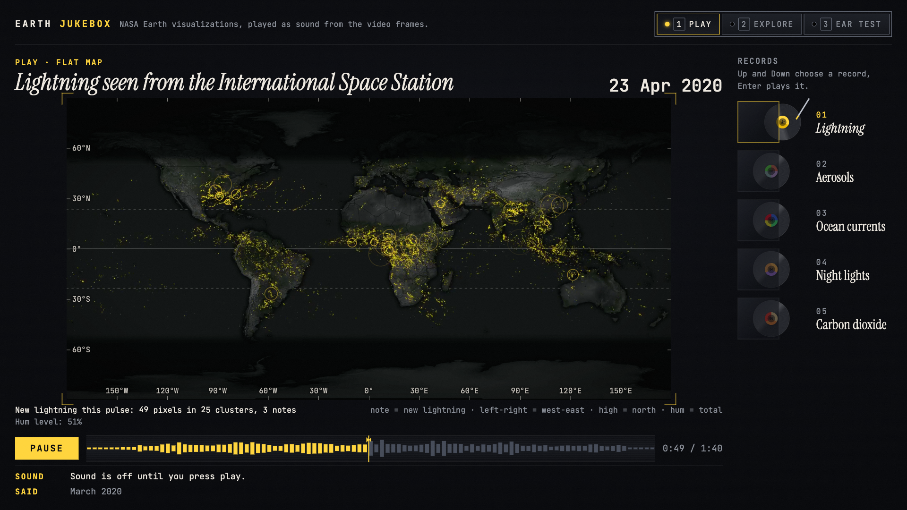

# Earth Jukebox

**Listen to NASA Earth visualizations.** Earth Jukebox plays five videos from NASA's Scientific Visualization Studio (SVS) and turns each frame into music while it plays. Where lightning strikes, how dust crosses the Atlantic, how warm the oceans are, where cities grew brighter, and how much carbon dioxide is in view: you can follow it all by ear, without seeing the screen.

It was built for the NASA Space Apps Challenge with blind and low-vision listeners in mind. Everything works from the keyboard and is spoken through a screen reader, and every sound is explained in plain words.

**Live:** https://earth-jukebox-orcin.vercel.app



## Run it

You need [Git LFS](https://git-lfs.com) (the videos are stored with it) and Node.js. It was developed and tested with Node.js 25.

```bash
git lfs install
git clone https://github.com/knsorrigle/juke.git
cd juke
npm install
npm run dev
```

Then open the address Vite prints, usually http://localhost:5173. Sound starts when you press play, because browsers only allow audio after a click or key press.

| Command | What it does |
| --- | --- |
| `npm run dev` | Development server |
| `npm test` | Unit tests (Vitest), including a WCAG colour-contrast check of the design tokens |
| `npm run lint` | Lint (oxlint) |
| `npm run build` | Type-check and build the static site into `dist/` |
| `node scripts/measure-moments.ts` | Re-measure the Ear Test moments from the videos (needs `ffmpeg`) |
| `node scripts/measure-activity.ts` | Re-measure the activity waveform drawn on the scrubber (needs `ffmpeg`) |

Add `?debug` to the address to show a tuning panel with live sliders and the frame rate.

There is no server: the site is static and all analysis and sound happen in the browser.

## How it works: frame → legend decode → music rules

```
NASA video ─▶ frame sampler ─▶ analysis ─▶ legend decode ─▶ music rules ─▶ sound engine ─▶ speakers
  (<video>)   (every frame)    (160 px)    (colour → meaning)  (per track)    (Tone.js)
```

1. **Frame.** On every new video frame (`requestVideoFrameCallback`, falling back to `requestAnimationFrame`), the frame is drawn onto a small canvas 160 px wide, downscaled in steps of at most 2× so thin features survive. Masks hide in-frame text such as legend boxes and date stamps. ([`src/analysis/frameSampler.ts`](src/analysis/frameSampler.ts))
2. **Analysis.** The pixels become numbers: brightness per column and row, frame-to-frame change per region, bright spots, newly lit pixels, and colour statistics. ([`src/analysis/features.ts`](src/analysis/features.ts))
3. **Legend decode.** Colours are turned back into what NASA's legend says they mean.
   - For category legends (aerosol types, lights, CO2 levels), each pixel is sorted into hue/saturation/brightness ranges set from the real video. Each class reports how much of the map it covers, where its centre is, and how much of it lies in each vertical slice. ([`classify.ts`](src/analysis/classify.ts))
   - For continuous colour bars (ocean temperature), each pixel's colour is matched to the nearest colour on NASA's colour bar in CIELAB space, giving an estimated value per grid cell. ([`colormap.ts`](src/analysis/colormap.ts))
4. **Music rules.** Each track has its own pure rule set: `step(features, videoTime, state, knobs)` returns notes to play and levels for held voices. All memory lives in an explicit `state`, so the rules are deterministic and unit-tested. Notes sit on a pentatonic scale and on a beat derived from the video's own clock. Seeking and looping are detected and reset the state. ([`src/mapping/`](src/mapping))
5. **Sound.** A Tone.js engine gives each track its own set of instruments (mallets, bells, plucks, pads, brass, breath, drones), crossfades between tracks, and runs everything through a compressor and limiter. Notes are scheduled against the video time with a small fixed delay, so the sound stays in step with the picture. ([`src/audio/engine.ts`](src/audio/engine.ts))

What is analysed is the picture NASA published. The app does not read the underlying science data files.

## The tracks

| Track | NASA SVS source | What it shows | What you hear | Why this mapping |
| --- | --- | --- | --- | --- |
| **Lightning** | [Lightning Events Detected from the ISS 2017–2023 (5011)](https://svs.gsfc.nasa.gov/5011/) | Lightning seen by the Lightning Imaging Sensor on the ISS, each moment showing a ten-day window, March 2017 to 2023. | Soft mallet notes for each new cluster of lightning: left–right is west–east, pitch is how far north, loudness is the cluster size. A hum and rumble underneath for the total amount of lightning. | Lightning is a crowd of separate, local events, so each cluster becomes a note placed where it happened. The total gives the seasonal swing north and south. |
| **Aerosols** | [GEOS Aerosols (5572)](https://svs.gsfc.nasa.gov/5572/) | Modelled airborne particles, 1 August to 14 September 2024: black carbon smoke, desert dust, sea salt and sulfate. | One instrument per type: brass for smoke, a breathy whistle for dust, bells for sea salt, plucks for sulfate. More of a type is louder or plays more often; left–right is where it is; higher is further north. Dust pans by the western edge of the plume. | The legend has four colours, so there are four distinct timbres you can pick out or solo. The dust's overall centre hardly moves because the Sahara stays dusty, but its western edge does as dust crosses the Atlantic. |
| **Ocean currents** | [Global Sea Surface Currents and Temperature (3912)](https://svs.gsfc.nasa.gov/3912/) | Modelled ocean surface currents (ECCO2) drawn as flowing lines, coloured by sea surface temperature, 0–32 °C. | Eight held notes, one per band of latitude: warmer water is a higher note. Faster-moving water makes its note brighter and shimmer. A scanner sweeps west to east every 8 s, playing the water under it. | Temperature is a continuous field that mainly changes with latitude, so a stack of held notes gives the overall shape. The scanner adds the west-to-east detail a stack cannot. |
| **Night lights** | [Change in Night Lights between 2012 and 2023 (5313)](https://svs.gsfc.nasa.gov/5313/) | Yearly night lights from 2012 to 2023 (Black Marble, Suomi NPP VIIRS), then a map of where light grew or faded. | First, a chord that grows fuller as the world gets brighter, with a scanner playing bell notes over lit places. Then, on the change map, a rising bell where lights are new and a falling low tone where lights went out. | The clip has two parts, a total that grows and a signed change. Rising and falling sounds match gain and loss, and silence means no change. |
| **Carbon dioxide** | [DYAMOND Global Carbon Dioxide (5196)](https://svs.gsfc.nasa.gov/5196/) | Carbon dioxide moving through the atmosphere, mid-January to early March 2020, on a slowly turning globe. | A quiet reference drone, and a main drone that rises, opens up and gets louder the more orange and red, high-CO2 colour is in view. A slow wobble follows the day–night pulse. | The camera orbits, so screen position is not a place on Earth. The sound tracks amount against a fixed reference instead of position. |

Each track also has a written description, a text alternative for the picture, and a plain-language legend that the app can read aloud.

## Modes

- **Play** (key 1): the video plays with its music.
- **Explore** (key 2): the frame pauses and a cursor moves over a 64-column grid. A tone and a spoken line say what is under the cursor and where it is, in degrees of latitude and longitude on map tracks.
- **Ear Test** (key 3): eight questions. Each plays two tones, left ear then right, made from two real moments in a track. Pick which moment shows more lightning, dust, light or CO2. The answer reveals both moments as video frames. There are three difficulty levels, and your best scores are kept in the browser.

## Accessibility

- **Keyboard only.** Every control and mode works from the keyboard, with a skip link and visible focus.
- **Screen readers.** A polite live region announces track changes, modes, answers and descriptions. While the intro or the Ear Test covers the page, the page behind it is made inert.
- **Descriptions on demand.** Keys describe the current frame (short or detailed, with numbers from the analysis), read the corner readouts, and explain what each sound means.
- **Captions.** A caption bar shows what is sounding, for people who cannot hear it.
- **Solo.** Any instrument can be played alone to learn what it does.
- **High contrast.** A high-contrast theme is checked by an automated WCAG contrast test.
- **Reduced motion.** The `prefers-reduced-motion` setting is respected: animations and fades are skipped.
- **Readable text.** At 1920×1080 all text is at least 16 px, so it stays readable on a projector. The only exception is the decorative numbers printed on the record labels.

### Keyboard map

| Key | Action |
| --- | --- |
| Space | Play or pause (in the Ear Test: start, hear again, next question) |
| Left / Right | Skip 5 seconds back or forward (in Explore: move the cursor; in the Ear Test: answer left or right) |
| Up / Down | On the record shelf: choose a record (Enter or Space plays it). In Explore: move the cursor |
| Shift + arrows | Move the cursor 10 cells at a time in Explore |
| 1 | Play mode (also leaves Explore and the Ear Test) |
| 2 | Explore mode |
| 3 | Ear Test |
| Shift + 1 to 4 | Solo instrument 1 to 4; press again to hear them all |
| I | Say what is under the Explore cursor |
| F | Describe the frame |
| G | Describe the frame in more detail |
| H | Read the corner readouts: mode, date, levels and a short legend |
| L | Explain what you are hearing |
| C | Switch high contrast on or off |
| Esc | Leave Explore or the Ear Test; skip the intro |

## Credits

All five visualizations are from the **NASA Scientific Visualization Studio (SVS)**, https://svs.gsfc.nasa.gov, retrieved on 14 November 2026. Full details, including source files, crops and trims, are in [`public/media/credits.json`](public/media/credits.json).

| Visualization | SVS page | Credit |
| --- | --- | --- |
| Lightning Events Detected from the International Space Station (ISS) 2017-2023 | [5011](https://svs.gsfc.nasa.gov/5011/) | NASA's Scientific Visualization Studio |
| GEOS Aerosols | [5572](https://svs.gsfc.nasa.gov/5572/) | NASA's Global Modeling Assimilation Office (GMAO) and NASA's Scientific Visualization Studio (SVS) |
| Global Sea Surface Currents and Temperature | [3912](https://svs.gsfc.nasa.gov/3912/) | NASA/Goddard Space Flight Center Scientific Visualization Studio |
| Change in Night Lights between 2012 and 2023 - EIC Version | [5313](https://svs.gsfc.nasa.gov/5313/) | NASA's Scientific Visualization Studio. Data: Black Marble (Suomi NPP VIIRS). NASA Earth Observatory images by Joshua Stevens, using Suomi NPP VIIRS data from Miguel Román, NASA GSFC. |
| DYAMOND Global Carbon Dioxide | [5196](https://svs.gsfc.nasa.gov/5196/) | NASA's Scientific Visualization Studio |

**How the videos were processed:**
- **Re-encoding:** all five were re-encoded with ffmpeg to H.264 at 720 px high and 30 fps, with the audio removed.
- **Aerosols:** the black letterbox bars were cropped off.
- **Night lights:** cropped to a single copy of the world map and trimmed to its first 21.8 s, the year series and the change map.
- **Lightning:** the date labels are NASA's own `labels.txt`, stored unmodified.
- **Colour bars:** the colour-bar images in `public/media/legends/` are NASA's, from the same SVS pages.

Earth Jukebox is an independent project made for the NASA Space Apps Challenge. It is not affiliated with or endorsed by NASA. The use of NASA visualizations does not imply endorsement by NASA. The music and the text descriptions are this project's own interpretation of the pictures. They are not part of NASA's visualizations.

## Limitations

- **Ocean temperatures are estimated from the legend, not read from data.** Each grid cell's colour is matched to NASA's 0–32 °C colour bar, which was sampled every 1.45 °C. Flow lines, shading, compression and coastlines all blur the colours, so treat the figures as approximate. Land and grey cells are ignored.
- **Carbon dioxide is colour intensity, not parts per million.** The CO2 sound follows how much of the view is orange or red, not a CO2 measurement. The reference drone stands for roughly where the colour bar turns from pale to orange, around 415 ppm, read off NASA's legend. The globe turns, so left–right and pitch do not tell you where anything is. The date shown is worked out from the frame number: the stamp reads 14 January 2020 22:00 on the first frame and advances one hour per frame.
- **Lightning dates: 2003 is shown as 2023.** NASA's `labels.txt` gives the year as 2003 on its last 1,074 lines, after December 2022. The dates are otherwise in order and the page describes data through 2023, so the app shows 2023. The stored file is not edited.
- **Positions are approximate.** Map edges were measured against the lightning map's coastlines. Night lights' latitude is good to about ±2°. The aerosols map's latitude could not be fitted, so it is assumed to cover the whole globe.
- **Small analysis frame.** Each frame is analysed at 160 px wide, so very small features are lost.
- **Hand-set colour ranges.** The colour categories are hue ranges set by hand from the real videos.
- **The dust drift is subtle.** The dust edge is where at least 3% of a map slice is dust, a threshold chosen by measuring the video. Its pan swings across only about a quarter of the stereo field, all left of centre. It is easier to hear on headphones with dust soloed (Shift+2).
- **Browser support.** Needs Web Audio. Exact frame timing needs `requestVideoFrameCallback`; other browsers fall back to animation frames, and timing is looser there. Developed and tested in Chromium-based browsers on macOS.
- **Not yet tested with real users.** The app has automated tests and manual checks, but it has not been tested with blind or low-vision users, with a real screen reader session, on a projector, or on a low-end laptop.
- **No recording.** You cannot save the music as an audio file.

## Use of AI

AI coding assistants (Claude / Claude Code) helped write and test the code, prepare the videos (cropping, trimming and re-encoding with ffmpeg), and draft the documentation, including this README.

All sound is synthesized live in your browser from the NASA video frames by the rules described above. The app contains no AI-generated images, video or audio, and it makes no calls to AI services while it runs.

## Tech

Vite, React, TypeScript, Tone.js, Zustand and Motion, with Vitest for tests. The fonts are Instrument Serif and JetBrains Mono, bundled through Fontsource. The site is hosted on Vercel as a static site.

## Licence

The code is released under the [MIT Licence](LICENSE).

The licence does not cover:
- **NASA material:** the videos, date labels and colour-bar images in `public/media/` are NASA's. Their credits are listed under Credits above, and NASA's own media guidelines apply to them.
- **Fonts:** Instrument Serif and JetBrains Mono are under the SIL Open Font License 1.1.
